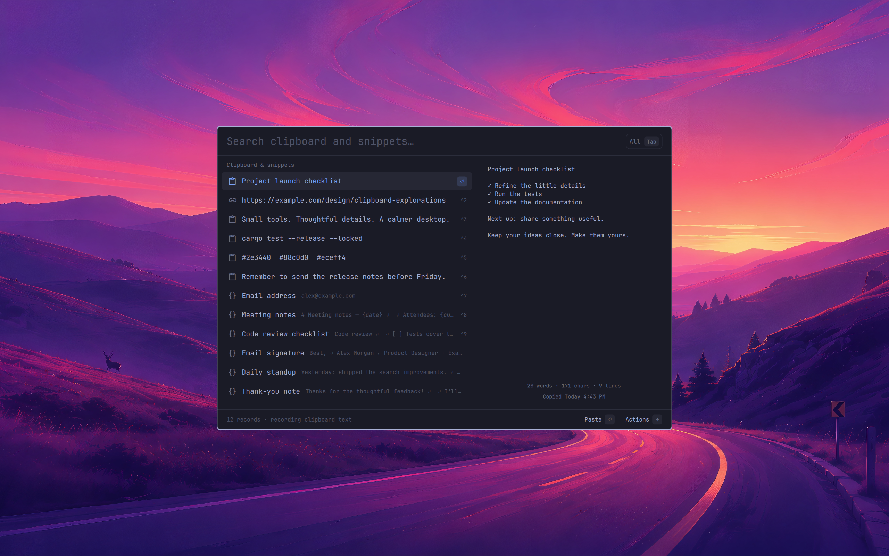

# Omarchy Snipboard

[](https://github.com/jwkicklighter/omarchy-snipboard/actions/workflows/ci.yml)

A native clipboard history and snippet picker for the Omarchy shell.



- Fuzzy search across clipboard text and saved snippets.
- Preview, copy, paste, and save clipboard entries as snippets.
- Create, edit, duplicate, and delete snippets.
- Keyboard-first controls and colors from your Omarchy theme.

**Early-stage prototype:** text only. Images, sync, and global typed expansion
are not implemented.

## Install

Requires Omarchy Quattro's plugin-capable shell, Linux x86_64 with glibc 2.39+,
Hyprland with `hyprctl eval`, wl-clipboard, util-linux (`setpriv`), and Python 3.11+.

```sh
omarchy plugin add https://github.com/jwkicklighter/omarchy-snipboard --enable
```

The plugin automatically downloads its pinned Rust worker from GitHub Releases
and verifies its SHA-256 checksum. No Rust toolchain or manual build is needed.
After installation, the cached worker runs offline.

## Use

Open the picker with the command below, or bind it to your preferred shortcut.
Installation does not add a keybinding.

```sh
omarchy-shell shell summon io.github.jwkicklighter.snipboard '{}'
```

| Key | Action |
| --- | --- |
| Enter / Ctrl+1–9 | Paste selected / numbered result |
| Tab | Switch between all, clipboard, and snippets |
| Right / Ctrl+K | Open actions |
| Ctrl+N / E / D | New / edit / duplicate snippet |
| Esc | Dismiss |

## Privacy

While enabled, Snipboard records clipboard text even when the picker is closed.
Source-marked sensitive selections are skipped, but this is **not universal
password detection**. Data stays local; there is no telemetry or upload.
Like other Omarchy plugins, Snipboard runs unsandboxed.

History and snippets live in
`${XDG_STATE_HOME:-$HOME/.local/state}/omarchy-snipboard-prototype/`.

## Update or remove

```sh
omarchy plugin update io.github.jwkicklighter.snipboard

# Stop capture and uninstall; saved data is retained.
omarchy plugin disable io.github.jwkicklighter.snipboard
omarchy plugin remove io.github.jwkicklighter.snipboard
```

Restart with `omarchy restart shell` if an update retains old UI code.
For a development checkout, use the [source-preserving uninstall](docs/development.md#disable-and-remove-without-deleting-source-or-data).

## Development

See [build and development instructions](docs/development.md),
[engine and plugin releases](docs/releases.md), and the [roadmap](docs/roadmap.md).

## License

[MIT](LICENSE).
